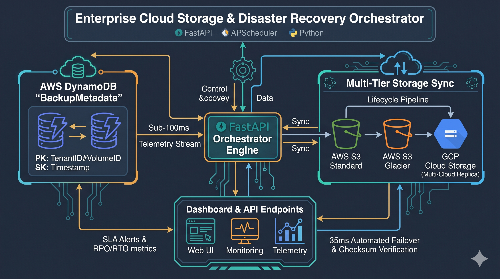

# Enterprise Cloud Storage & Disaster Recovery Orchestrator

[](https://www.python.org/)
[](https://fastapi.tiangolo.com/)
[](https://aws.amazon.com/)
[](https://www.docker.com/)

An automated cloud storage lifecycle and disaster recovery (DR) orchestrator built with Python, FastAPI, Boto3, and Docker. The system simulates multi-tenant volume snapshotting, deterministic state machine workflows, policy-driven storage tiering across AWS S3 Standard and Glacier, cross-cloud replication, and low-latency telemetry logging into Amazon DynamoDB to benchmark real-time RPO and RTO compliance.

---

## Architecture Overview



The workflow connects the background automation, NoSQL telemetry ingest, and multi-tier storage layers:

- **FastAPI & APScheduler (Execution Daemon):** Automated background cycles trigger, ingest, verify, and store volume data.
- **AWS DynamoDB (Sub-100ms Audit Log):** Fast state-tracking metrics, partitioning on volume and temporal scale.
- **AWS S3 & Cloud Storage (Storage Tiers):** Live placement across standard, archived, and replicated multi-cloud instances.
- **REST APIs & Dashboard:** User and engine visibility, driving performance alerts and emergency on-demand restorations.

---

## Key Features

1. **Deterministic State Machine Workflow**
   - Snapshots transition through an explicit 5-stage finite lifecycle:
     $$\text{TRIGGERED} \longrightarrow \text{INGESTING} \longrightarrow \text{VERIFYING\_CHECKSUM} \longrightarrow \text{S3\_TIERING} \longrightarrow \text{COMPLETED}$$
   - Includes state rollback and `FAILED_RETRY` logging on ingestion failure.

2. **Cryptographic Bit-Rot Prevention**
   - End-to-end data integrity is enforced by generating SHA-256 hashes during ingestion.
   - Failover restore routines recompute payloads on the fly to detect and prevent silent data corruption before mounting.

3. **Multi-Tier & Cross-Cloud Replication**
   - Automatically writes snapshots to **Hot Tier** (`S3 Standard`).
   - Simulates lifecycle transition policies moving older snapshots to **Cold Archive** (`S3 Glacier`), reducing storage overhead.
   - Replicates payload streams to a secondary cloud archive bucket (`gcp-cloud-storage-replica`) for cross-cloud redundancy.

4. **Sub-100ms NoSQL Telemetry (DynamoDB)**
   - Single-table design optimized for high-throughput write streams:
     - **Partition Key (`PK`):** `TenantID#VolumeID` (e.g., `tenant-corp#vol-001`)
     - **Sort Key (`SK`):** `Timestamp` (epoch numeric)
   - Enables sub-100ms latest-snapshot queries (`ScanIndexForward=False, Limit=1`) without expensive table scans.

5. **Live SLA Dashboard & Failover Execution**
   - Web interface (`/dashboard`) monitoring continuous **Recovery Point Objective (RPO)** and **Recovery Time Objective (RTO)** benchmarks.
   - Interactive recovery triggers enabling instant disaster recovery failover drills.

---

## Tech Stack

- **Backend / API:** Python 3.11, FastAPI, Uvicorn, Pydantic v2
- **Scheduler:** APScheduler (Background Execution)
- **Cloud Infrastructure & SDK:** AWS SDK (`boto3`), S3, DynamoDB, EC2
- **Local Cloud Emulation:** LocalStack v3.4 (S3 & DynamoDB endpoints)
- **Containerization:** Docker, Docker Compose (Multi-stage networking & health checks)
- **Frontend / Console:** HTML5, Tailwind CSS, Vanilla JavaScript (Event polling)

---

## Quickstart (Local Docker)

### Prerequisites
- Docker Desktop with WSL 2 enabled (Windows) or native Docker Engine (Linux/macOS)
- Git

### 1. Clone the Repository
```bash
git clone [https://github.com/](https://github.com/)<YOUR-USERNAME>/cloud-dr-orchestrator.git
cd cloud-dr-orchestrator
